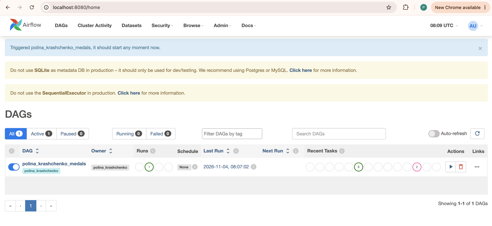
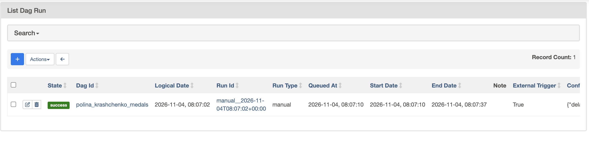
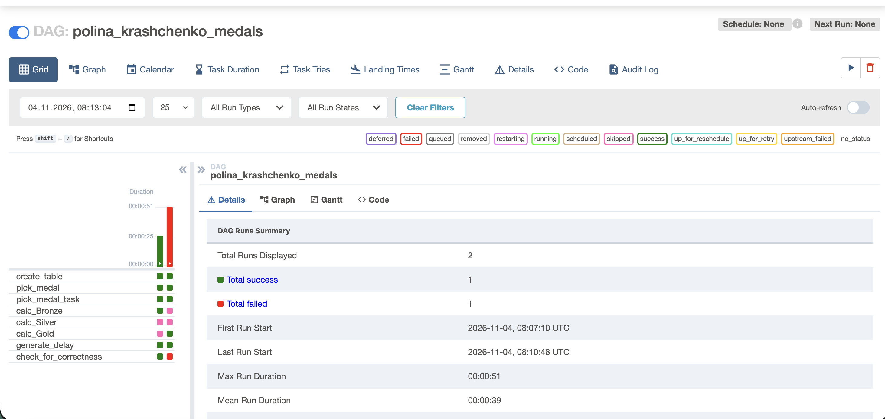
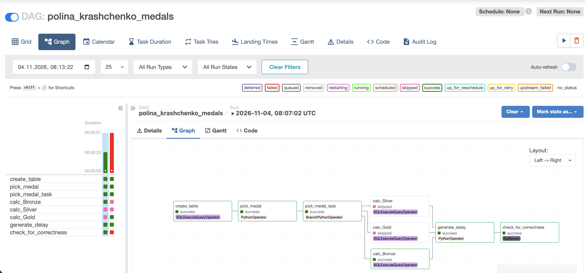
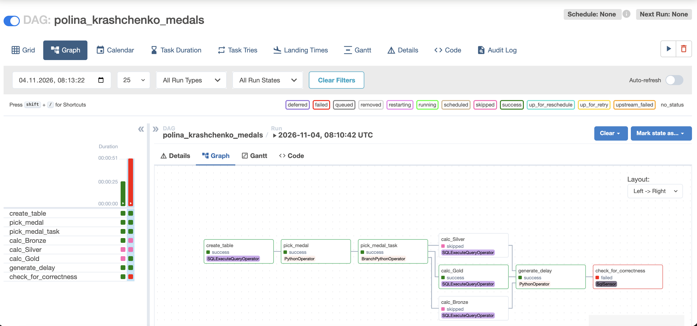
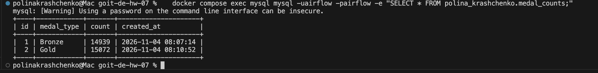

# goit-de-hw-07 — Apache Airflow

DAG `polina_krashchenko_medals` (`dags/polina_krashchenko_medals_dag.py`) запускається локально:
MySQL і Airflow піднімаються в Docker (`docker-compose.yml`), як погоджено з ментором,
оскільки доступу до серверів курсу немає.

## Завдання DAG

| # | Task | Що робить |
|---|---|---|
| 1 | `create_table` | `CREATE DATABASE/TABLE IF NOT EXISTS polina_krashchenko.medal_counts` (`id` AUTO_INCREMENT PK, `medal_type`, `count`, `created_at`) |
| 2 | `pick_medal` | випадково обирає `Bronze`, `Silver` або `Gold` |
| 3 | `pick_medal_task` | `BranchPythonOperator`: за обраним значенням запускає одне з трьох завдань |
| 4 | `calc_Bronze` / `calc_Silver` / `calc_Gold` | `SQLExecuteQueryOperator`: рахує записи з відповідною медаллю в `olympic_dataset.athlete_event_results` і вставляє `medal_type`, `count`, `created_at = NOW()` |
| 5 | `generate_delay` | `PythonOperator` з `time.sleep(n)`, `trigger_rule=ONE_SUCCESS` |
| 6 | `check_for_correctness` | `SqlSensor`: найновіший запис не старший за 30 секунд |

Затримка задається параметром `delay_seconds` у **Trigger DAG w/ config**:
`20` → сенсор **success**, `35` → сенсор **failed**.

## Локальне середовище

- `mysql` — MySQL 8.0; `mysql-init/01_init.sql` створює `olympic_dataset.athlete_event_results`
  і заповнює її з `data/athlete_event_results.csv` через `LOAD DATA INFILE`.
- `airflow` — `apache/airflow:2.8.1`, команда `standalone`, папка `dags/` змонтована;
  підключення задано змінною `AIRFLOW_CONN_GOIT_MYSQL_DB`, встановлено `apache-airflow-providers-mysql`.

## Запуск

```bash
curl -o data/athlete_event_results.csv https://ftp.goit.study/neoversity/athlete_event_results.csv
docker compose up -d
docker compose exec airflow cat /opt/airflow/standalone_admin_password.txt   # пароль для admin
```

UI: http://localhost:8080 (логін `admin`).

Перевірка таблиці результатів:
```bash
docker compose exec mysql mysql -uairflow -pairflow -e "SELECT * FROM polina_krashchenko.medal_counts;"
```

## Скриншоти

### Список DAG-ів: перший запуск успішний


### Запуск із затримкою 20 с — success


### Grid: два запуски (20 с — success, 35 с — сенсор failed)


### Graph: затримка 20 с — обрано Bronze, сенсор success


### Graph: затримка 35 с — обрано Gold, сенсор failed


### Таблиця результатів `polina_krashchenko.medal_counts`

